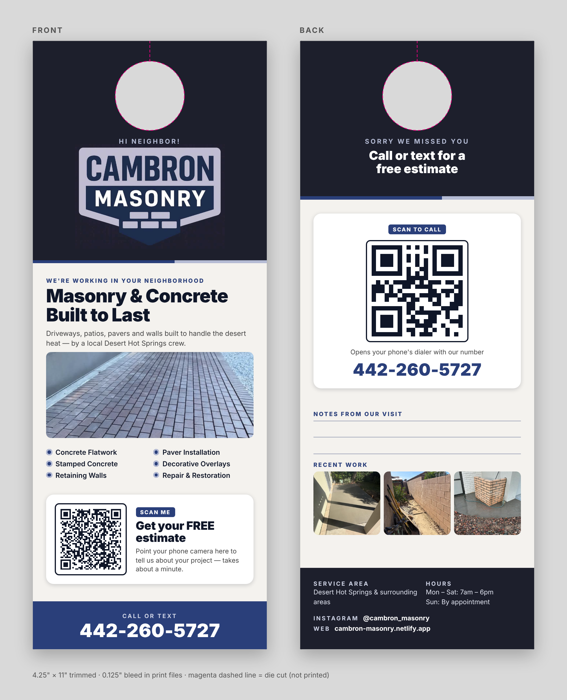

# Door Hangers — Cambron Masonry



Standard **4.25" × 11"** door hanger, two sides, with a 1.25" hang hole centered 1" from the top.

| Side  | QR code goes to | Purpose |
|-------|-----------------|---------|
| Front | `https://cambron-masonry.netlify.app/contact.html?utm_source=door-hanger` | Opens the guided free-estimate form |
| Back  | `tel:+14422605727` | Opens the phone dialer with 442-260-5727 |

Both codes were checked by decoding them from the rendered 300 DPI files.

## Files (`output/`)

| File | Use |
|------|-----|
| `door-hanger-proof.png` | Both sides trimmed, side by side, with the die line. Use it to look over and approve the design. |
| `door-hanger-print.pdf` | **Send this to the printer.** 2 pages (front, back), 4.5" × 11.25" including 0.125" bleed. Text and QR codes are vector. |
| `door-hanger-front-300dpi.png` / `-back-300dpi.png` | 1350 × 3375 px raster versions with bleed, for printers that want images |
| `door-hanger.html` | Generated source, which opens in a browser |

## Printer notes

- Trim: 4.25" × 11". Bleed: 0.125" on every side. Text stays at least 0.25" inside the trim.
- Die cut: 1.25" round hole whose center sits 1" below the trim top, plus a slit from the hole to the top edge. Most door-hanger templates (Vistaprint, GotPrint, etc.) use this same die. If your printer's die is different, adjust `HOLE` in `generate.js` and rebuild.
- The magenta dashed die line appears only on the proof, never in the print files.
- Suggested stock: 14–16 pt cardstock with a matte or uncoated back, so the "Notes from our visit" lines can be written on.

## Editing and rebuilding

Copy (phone, services, hours, QR targets) lives in the `BIZ` object at the top of `generate.js`.

```bash
cd marketing/door-hangers
npm install
node generate.js
```

This needs Playwright with Chromium. Photos come from `images/portfolio/` at the root of the site repo.
